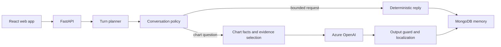

# AstroGnani

A consumer AI astrology assistant with web chat and voice input, built during my AI internship at [Gnani.ai](https://gnani.ai) (June to August 2026).

**Live:** [astro.gnani.site](https://astro.gnani.site)

> This repository is a public overview. The source code belongs to Gnani.ai and stays private.

## Overview

AstroGnani brought Gnani.ai's voice AI into a consumer product. A user signs in with their mobile number, enters their birth details once, and then asks questions in plain language, by typing or by speaking. Answers are grounded in that user's own Vedic birth chart, and the assistant remembers earlier conversations, so returning users pick up where they left off.

## What I built

I owned the Python backend and the conversation system behind it.

- **Conversation pipeline.** Each message passes through a turn planner that decides the topic and action, a conversation policy that handles follow-up answers, topic switches, and missing details, and an answer contract that tells the language model exactly which facts it may use.
- **Grounded answers.** Charts are computed with Swiss Ephemeris (PyJHora). An evidence selector sends the model only the relevant, traceable chart facts, and an output guard checks every reply before it reaches the user. The model writes prose; it never calculates charts.
- **Fast paths without the model.** Greetings, glossary questions, memory recall, and other bounded requests are answered by deterministic routes, which saves cost and latency.
- **Memory.** Conversation turns, session summaries, and user context persist in MongoDB, with optional Redis caching for profiles, context, and evidence.
- **Languages and voice.** Replies in English, Romanized Hindi (Hinglish), and Devanagari Hindi. Voice input uses Gnani's speech-to-text, with an editable transcript before sending.
- **Partner questions.** Compatibility questions can collect a partner's details through a dedicated panel without changing the user's own profile.
- **Testing and operations.** 560+ backend tests, a mock provider for deterministic runs, latency reports, and a Docker setup for the full stack.

## Architecture

## Stack

Python · FastAPI · Pydantic · Azure OpenAI · MongoDB · Redis · Gnani speech-to-text · PyJHora (Swiss Ephemeris) · React · Vite · Tailwind CSS · Docker

---

[Profile](https://github.com/adhvikrayaprolu) · [LinkedIn](https://www.linkedin.com/in/adhvikrayaprolu)
